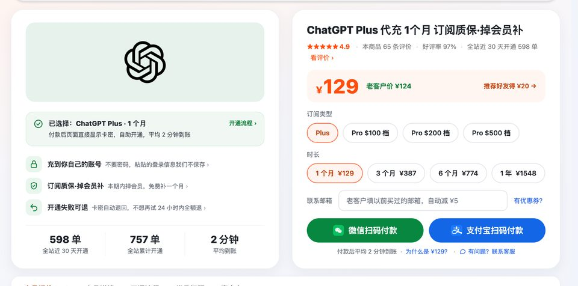
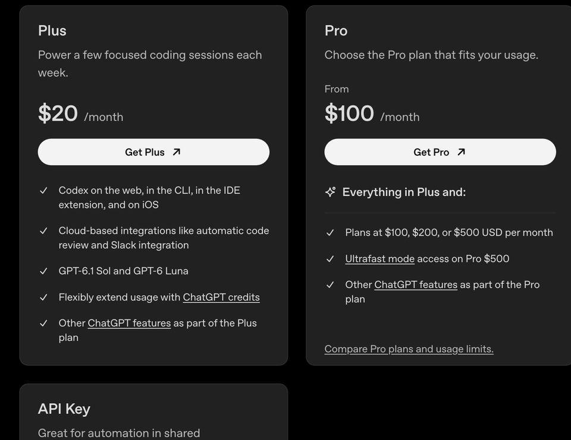
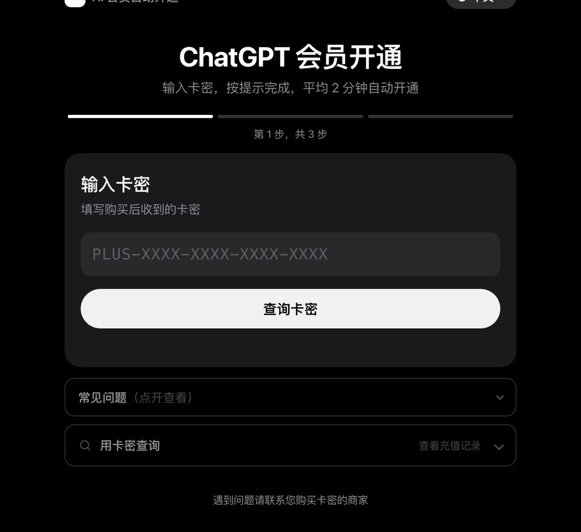

# GPT订阅 2026：ChatGPT 订阅四种方式、国内哪种能付、订阅失败怎么办

> 2026-11-10 更新

**先说结论：** GPT订阅说到底就四条路：官网绑卡、iPhone 应用内购、安卓 Google Play、找代充，前三条都要外币卡和支持地区的账号，国内多数人卡在付款这一步。最省事的是在瑶瑶ai训练师的商城下单 [ChatGPT订阅 Plus，¥129 开 1 个月](https://kw.yaoyao.chat/item/5?utm_source=github&utm_medium=readme&utm_campaign=dingyue&utm_content=top)，支付宝、微信付，拿卡密自己兑换，平均 2 分钟到账；不绑卡、到期不自动扣钱。下单填券码 **888888** 再减 ¥3。

- **四种方式差在哪**：谁收钱、要什么卡、在哪取消不一样，会员内容完全一样，开的都是你自己账号上的 Plus。
- **国内哪种能付**：官网只收信用卡、借记卡和少数国家的本地支付，没有支付宝、微信；中国大陆、香港、澳门也不在 OpenAI 的支持名单里。
- **订阅失败**：最常见的是发卡行不在支持地区、3D 验证没走完、同一张卡或设备上的订阅太多，下面逐条对照。
- **谁不用买**：人在支持地区、有当地发的卡，官网订最直接；一周只开两三次、只聊天的，免费版的日常文字聊天本来就不限次数。

*图：瑶瑶ai训练师商城的 ChatGPT Plus 页，1 个月、3 个月、6 个月、1 年在同一页切换（kw.yaoyao.chat/item/5，截于 2026-11-10）*

## GPT订阅的四种方式，一张表对比

先把 chatgpt 订阅的四条路摆在一起。2026-11-10 对过 OpenAI 帮助中心、中文定价页和多币种账单页：

| 方式 | 谁收钱、谁管 | 要准备什么 | 会不会自动续 | 国内能不能走 |
|---|---|---|---|---|
| 官网 chatgpt.com 绑卡 | OpenAI | 支持地区发的信用卡、借记卡；少数国家另有本地支付 | 会，按订阅日每月扣 | 国内卡多半被拒 |
| iPhone 应用内购 | Apple | 支持地区的 Apple 账号和付款方式 | 会 | 国区 App Store 走不通 |
| 安卓 Google Play | Google | 支持地区的 Google Play 国家和当地付款方式 | 会 | 国区 Google 账号没有入口 |
| 代充（卡密或订单页填信息） | 卖家 | 一个能登录的 ChatGPT 号，加支付宝或微信 | 不会，到期自己再买 | 能 |

四条路开出来的会员一模一样，聊天记录、记忆、模型都在原来的号上。区别全在"付钱"这一环：谁收钱、出了问题找谁、怎么取消。

另外两样常被人当成订阅方式的，其实走不通：OpenAI 官方礼品卡和钱包余额，帮助中心写明目前只在美国能用、按美元记；年付也没有，官方 Go、Plus、Pro 都只按月收。

*图：OpenAI 官方 Codex 定价页上的 Plus 和 Pro 卡片，Plus 每月 20 美元，Pro 100 美元起。来源 learn.chatgpt.com/docs/pricing，截于 2026-11-10*

## 官网订阅：要什么卡、在哪点

**入口**：网页登录 chatgpt.com，点头像 → Upgrade plan（升级套餐）→ 选 Plus。看不到想要的套餐或币种，帮助中心建议先看定价页底部选的国家对不对。

**收什么付款方式**（多币种账单页，2026-11-10）：

- 所有地区：信用卡、借记卡；
- 美国：符合条件的账号可以用 ChatGPT 钱包余额；
- 英国、欧洲经济区：部分可用 Link 银行借记；
- 印度 UPI（Go、Plus 能用，Pro 不行）、印尼 GoPay、巴西 Pix、韩国 Kakao Pay 和 Naver Pay、菲律宾 GCash、越南 MoMo。

名单里没有支付宝、微信。中文定价页的常见问题也只写了一句：可以用任何主要信用卡购买 Go、Plus、Pro。

**几个官网订阅的规矩**：

- 按订阅那天每月循环扣，账单日改不了；
- 订阅中途不能换币种，要换得先取消、等这一期结束再重订；
- 取消只是停掉下一次续费，这一期照样用到底。

ChatGPT 订阅之后状态在哪看、会不会自动扣，卡网有一页专门讲：[ChatGPT Plus 怎么订阅、状态在哪看](https://kw.yaoyao.chat/guide/chatgpt-plus-dingyue.html?utm_source=github&utm_medium=readme&utm_campaign=dingyue&utm_content=guide)；第一次升级的按钮在哪，见 [ChatGPT 免费版怎么升级 Plus](https://kw.yaoyao.chat/guide/chatgpt-shengji-plus.html?utm_source=github&utm_medium=readme&utm_campaign=dingyue&utm_content=guide)。

## 手机里订：苹果和安卓各归谁管

**iPhone**：在 ChatGPT App 对话顶部点 Upgrade，或从设置里点升级，付款走 Apple，订阅由 Apple 管理。帮助中心写明，iOS App 只在 ChatGPT 支持的国家和地区提供。新用户订阅按钮发灰、提示"In-app purchases are currently unavailable"，官方让你稍后再试，或者去网页看能不能订。

**安卓**：在 App 里点升级，付款走 Google Play，取消和改付款方式都在 Google Play 的"付款和订阅"里。Google Play 国家要在支持地区，付款方式要是那个地区能用的，虚拟信用卡 Google 不收。

手机订阅有两个坑，官方都提醒过：

- **订阅绑死在两个账号上**：付钱的 Apple / Google 账号，和当时登录的 ChatGPT 账号。换个 ChatGPT 号，会员不会跟过去。
- **卸载 App 不等于取消**。要去 iPhone 的"设置 → 你的名字 → 订阅"，或 Google Play 的订阅页里手动取消。

## 卡点：国内卡为什么总被拒，付了钱为什么还是免费版

这是 gpt 订阅里最让人上火的两件事，同行大多一句"换张卡"带过。拆开讲：

### 国内卡被拒，多半不是卡的问题

OpenAI 帮助中心那篇《Why was my credit card declined?》把拒付原因分成三类，第三类最关键：**购买只在支持的国家和地区提供，付款卡也必须是这些地区的银行发的**。中国大陆不在名单上，所以国内银行发的 Visa、万事达，就算额度够、能付境外，也经常过不了。

另外两类，换了卡也可能碰到：

- **银行拦了**：卡号、有效期、CVC、账单地址和邮编对不上，或者银行默认拦境外线上交易。官方说他们一般拿不到银行的具体拒绝原因，直接问银行最快。
- **3D 验证没走完**：看到"需要验证""3D Secure 失败"这类提示，官方建议关掉拦截弹窗的插件、换无痕窗口或换浏览器重试，验证过程中别关页面、别刷新。

账单地址校验不过的具体排查，见 [ChatGPT 付款提示账单信息无效怎么办](https://kw.yaoyao.chat/guide/chatgpt-billing-invalid.html?utm_source=github&utm_medium=readme&utm_campaign=dingyue&utm_content=guide)；哪些情况自己改改能过、哪些情况换什么卡都没用，见 [ChatGPT 付款失败怎么办](https://kw.yaoyao.chat/guide/chatgpt-zhifu-xiezhu.html?utm_source=github&utm_medium=readme&utm_campaign=dingyue&utm_content=guide)。

### 付了钱，ChatGPT 还显示免费版

Plus 介绍页底下专门有一段排查，按顺序做：

1. **先确认登录的是哪个号**。网页"设置 → 账户"里看邮箱。收据发到的邮箱，不一定就是 ChatGPT 账号的邮箱。
2. **用 Apple 登录又选了隐藏邮箱的**，账号邮箱会是一个 `@privaterelay.appleid.com` 地址，要用同一个 Apple 账号点"Continue with Apple"进去。
3. **手机上点"恢复购买"**。iOS 或安卓 App 的设置里有 Restore purchases，用来同步订阅。
4. **退出再登录**。在显示免费版的那台设备上登出，换回付款的那个号重新登录。
5. **还不行再联系官方**，附上收据，或者扣款那张卡的末四位。

还有一种情况容易被当成"付了没到账"：同时登着几个号，或者加入过公司的 Business 工作区，当前选中的不是付钱的那个个人账号。官方排查的第一步就是先看清当前选中的是哪个账号，切过去再看套餐状态。

千万别在没查清楚之前再付一次，官方几篇帮助文章都反复提醒：先查是哪个号拥有这份订阅，不然很容易重复扣费。

## 订阅失败怎么办：报错逐条对照

| 你看到的 | 意思 | 怎么办 | 官方出处 |
|---|---|---|---|
| 卡被拒、付款失败 | 银行拦了，或卡不是支持地区发的 | 核对卡信息、问银行；发卡地不对换什么都没用 | [信用卡被拒的原因](https://help.openai.com/articles/7232916) |
| 需要验证 / 3D Secure 失败 | 银行的验证没走完 | 关拦截插件、换无痕窗口，验证时别关页面 | 同上 |
| Too many subscriptions associated with this card or device | 同一张卡或设备上的订阅太多，被 OpenAI 限制 | 用已有的可用账号，或找官方复核；这不是银行拒付 | [卡和设备限制说明](https://help.openai.com/articles/20001559) |
| Device limit reached | 这台设备用过的付费号太多 | 换一个允许的号，或取消并退款 | 同上 |
| In-app purchases are currently unavailable | iPhone 内购暂时不可用 | 稍后再试，或去网页看 | [iOS 升级说明](https://help.openai.com/articles/7905739) |
| 购买已关联到另一个 OpenAI 账号 | Apple / Google 账号以前给别的号订过 | 用原来那个号登录；要给新号买，去网页 | [订阅和账号](https://help.openai.com/articles/20001056) |
| 被扣了两份 | 网页、苹果、Google Play 各订了一份 | 留一份，取消其余；苹果的找苹果退 | [避免重复扣费](https://help.openai.com/articles/20001043) |

## 国内实际怎么订：代充这条路怎么走

前三条官方路子，国内用户真正能走通的不多。剩下的是代充：钱付给卖家，卖家把会员开到你自己的号上。瑶瑶店里的做法（2026-11-10 事实卡）：

| 时长 | 价格 | 怎么开 |
|---|---|---|
| 1 个月 | ¥129 | 付款后自动发卡密，到 cz.yaoyao.chat 自助兑换 |
| 3 个月 | ¥387 | 一单 3 张卡密，到期充下一张 |
| 6 个月 | ¥774 | 一单 6 张卡密 |
| 1 年 | ¥1,548 | 付款后在订单页填一次登录信息，在线开通，一次开满 12 个月 |

*图：瑶瑶的 ChatGPT 会员开通页，第 1 步输入卡密（cz.yaoyao.chat 空表单，截于 2026-11-10）*

chatgpt订阅教程 照这四步来：

1. 在商城付款，支付宝或微信都行，页面直接给卡密。
2. 用浏览器（别用 App）登录 ChatGPT，新开标签页打开 `chatgpt.com/api/auth/session`，全选复制。
3. 到 cz.yaoyao.chat 输卡密、粘贴，核对认出来的邮箱，点开通，平均 2 分钟到账。
4. 开完在 ChatGPT"设置 → 安全"里退出所有设备，刚才那段登录信息就失效了。

跟官网订阅比，代充有三点不一样，提前知道免得慌：

- **不自动续费**。不绑你的卡，订阅页显示"已取消"或一个到期日都是正常的，到期想续再买。续费怎么接上，见 [ChatGPT Plus 到期怎么续费](https://kw.yaoyao.chat/guide/plus-xufei.html?utm_source=github&utm_medium=readme&utm_campaign=dingyue&utm_content=guide)。
- **账号上有没到期的订阅就先别交卡密**。会提示已有订阅，这次不扣卡密，等到期再交。
- **售后找卖家**。瑶瑶店里：没开成卡密自动退回，不想再试 24 小时内全额退回原支付宝或微信；开成后本期内掉会员补一个月；封号不在质保范围、不退款，ChatGPT 封号可以协助重新注册一个号。

要全年不断档、懒得每月折腾的，选 [GPT订阅 1 年 ¥1,548](https://kw.yaoyao.chat/item/5?d=12&utm_source=github&utm_medium=readme&utm_campaign=dingyue&utm_content=mid-year)；店里几个时长都是 ¥129 乘月数，长档不打折。代充和官网绑卡的费用、售后逐项对比，在 [瑶瑶代充和官方信用卡订阅对比](https://kw.yaoyao.chat/guide/vs-guanfang.html?utm_source=github&utm_medium=readme&utm_campaign=dingyue&utm_content=guide)；按月买还是一次买几个月更省，见 [ChatGPT Plus 怎么买最划算](https://kw.yaoyao.chat/guide/plus-zuihuasuan.html?utm_source=github&utm_medium=readme&utm_campaign=dingyue&utm_content=guide)。

订阅以后能用到哪些功能、和 Go、Pro 怎么分，这篇不展开，开头那几篇里有；只想要个便宜档的，Go 的情况见 [ChatGPT Go 值得买吗](https://kw.yaoyao.chat/guide/chatgpt-go.html?utm_source=github&utm_medium=readme&utm_campaign=dingyue&utm_content=guide)；想按量付费的，订阅和 API 哪个划算见 [ChatGPT 订阅和 API 怎么选](https://kw.yaoyao.chat/guide/dingyue-vs-api.html?utm_source=github&utm_medium=readme&utm_campaign=dingyue&utm_content=guide)。

## 常见问题

**问：GPT订阅能用支付宝或微信吗？**
官网不行。官方收信用卡、借记卡和少数国家的本地支付，没有支付宝、微信；想用这两样，只能通过代充，钱付给卖家。

**问：chatgpt 订阅会自动续费吗？**
官网、苹果、Google Play 订的都会按月自动续，可以随时取消、用到这期结束。代充开的不绑付款方式，到期不扣钱。

**问：gpt 订阅能一次付一年吗？**
官方不能，Go、Plus、Pro 都只按月付，也不能预付几个月。卖家的"一年"是自己的套餐，瑶瑶店里 1 年是一次开满 12 个月。

**问：订阅了以后能换成别的付款方式吗？**
官网订阅中途不能换币种；想从苹果、Google Play 换到网页，要先在原平台取消、等到期再订，不然会扣两份。

**问：chatgpt订阅教程里说的"登录信息"是密码吗？**
不是。是登录后在 `chatgpt.com/api/auth/session` 页面复制的一段文字，不含密码；开完退出所有设备就作废。

**问：手机订的会员，电脑上能用吗？**
能。会员跟着 ChatGPT 账号走，同一个号在网页、手机、电脑登录都是同一个订阅。

**问：GPT订阅失败，钱扣了会员没到怎么办？**
先确认登录的是不是付款那个号、点恢复购买、退出重登；还不行带收据联系官方。别着急再付一次。

决定好了，就从 [GPT订阅教程里用的 Plus 一个月 ¥129](https://kw.yaoyao.chat/item/5?utm_source=github&utm_medium=readme&utm_campaign=dingyue&utm_content=end) 开始；券码 **888888** 结账减 ¥3，不和推荐码、老客户减 ¥5 叠加。售后找瑶瑶企业微信，海外不方便用微信的发邮件到 support@yaoyao.chat，写上订单号。

## 相关教程

- [ChatGPT Plus购买](https://github.com/yaoyao-chat/plus)：订阅前想弄清 Plus 都有哪些功能，看这篇
- [ChatGPT充值教程](https://github.com/yaoyao-chat/chongzhi)：卡密到手以后充值页每一屏怎么填
- [ChatGPT价格](https://github.com/yaoyao-chat/jiage)：免费版、Go、Plus、Pro 官方价对照

原文地址：[github.com/yaoyao-chat/dingyue](https://github.com/yaoyao-chat/dingyue)（CC BY-ND 4.0，转载请保留原文地址、不得改编）

## 核对与来源

瑶瑶店里的四个时长、价格、退款和补会员规矩，取自 11 月 10 日凌晨导出的商城事实卡；下面这些 OpenAI 和 Google 页面，都是 2026-11-10 当天一页页打开对过的：

- [OpenAI 帮助：多币种账单和各地付款方式](https://help.openai.com/articles/10421635)：各地区付款方式（卡、Link、UPI、GoPay、Pix、Kakao Pay、Naver Pay、GCash、MoMo、美国钱包余额）；礼品卡只在美国；订阅中途不能换币种；App 订阅由 Apple / Google 管
- [ChatGPT 中文定价页](https://chatgpt.com/zh-Hans-CN/pricing/)：常见问题"可以使用任何主要信用卡购买 Go、Plus、Pro"
- [OpenAI Codex 价格说明](https://learn.chatgpt.com/docs/pricing)：Plus 20 美元、Pro 100 美元起
- [OpenAI 帮助：Plus 介绍](https://help.openai.com/articles/6950777)：网页升级路径、付了钱还显示免费版的排查步骤、不支持年付
- [OpenAI 帮助：Go 介绍](https://help.openai.com/articles/11989085)：Go、Plus、Pro 都不支持年付和预付多月
- [OpenAI 帮助：信用卡为什么被拒](https://help.openai.com/articles/7232916)：银行拒付、3D 验证、卡必须由支持地区银行发行
- [OpenAI 帮助：ChatGPT 支持的国家和地区](https://help.openai.com/articles/7947663)：大陆、港澳均未列入
- [OpenAI 帮助：iOS App 怎么升级](https://help.openai.com/articles/7905739)：iOS 两个升级入口、Apple 管理、内购不可用时的提示
- [OpenAI 帮助：卡和设备数量限制](https://help.openai.com/articles/20001559)：卡和设备订阅数量限制的提示原文
- [OpenAI 帮助：订阅和账号对不上](https://help.openai.com/articles/20001056)：订阅不能在账号间转移、购买关联到另一个账号
- [OpenAI 帮助：怎样避免被扣两次](https://help.openai.com/articles/20001043)：卸载不取消、换平台先取消再订、各平台取消路径
- [OpenAI 帮助：账单日规则](https://help.openai.com/articles/8156167)：按订阅日每月循环扣、账单日不能改

## 关于作者与声明

这篇是瑶瑶ai训练师写的。瑶瑶从 2023 年 10 月开始做 AI 科普，kw.yaoyao.chat 是瑶瑶自营的商城，所有商城链接都是自家广告。代充不属于官方渠道，这家店和 OpenAI 没有隶属关系，也没拿过授权，订阅规则以 OpenAI 官方页面为准。任何人问你要账号密码或验证码都别给，包括自称瑶瑶客服的；客服只在企业微信 `kw.yaoyao.chat/wecom`。
